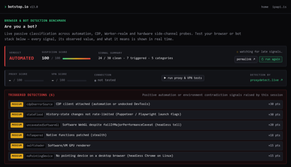
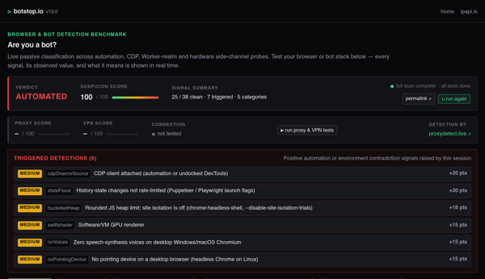
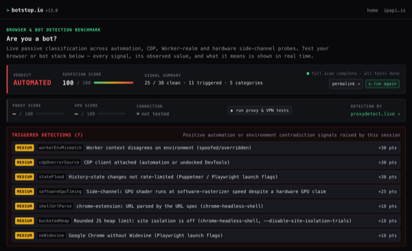
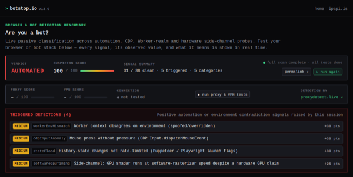
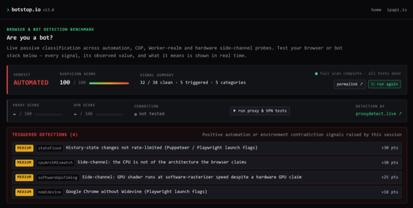
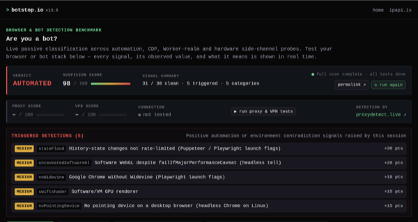
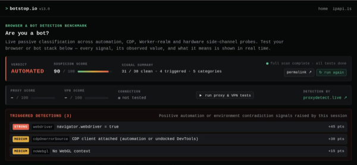
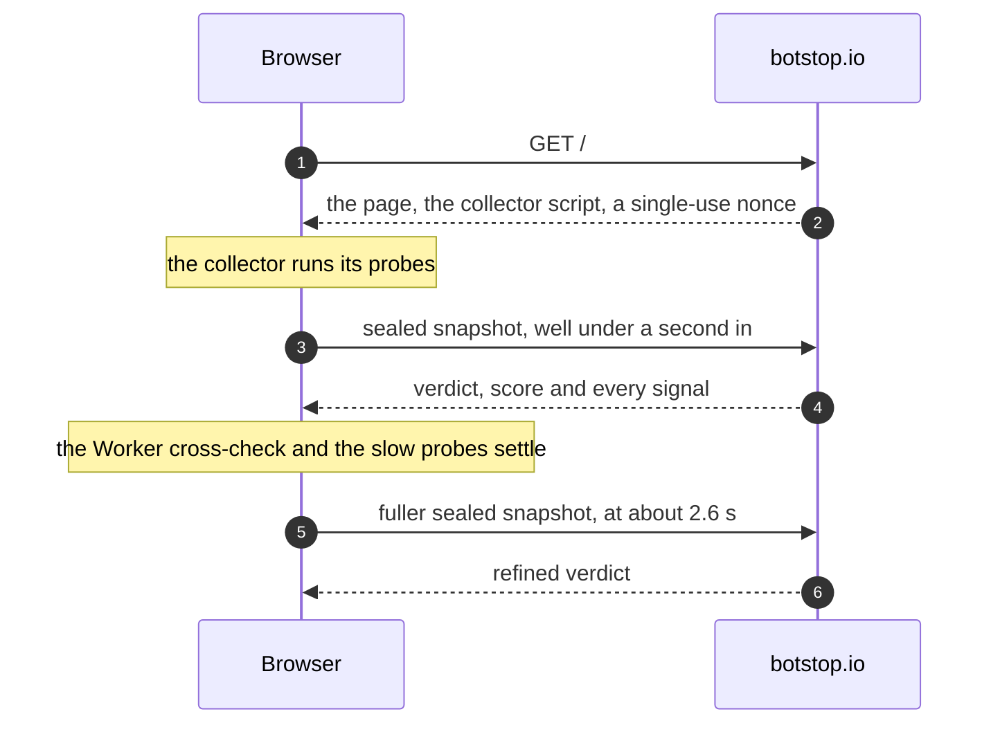

  

# botstop.io

[botstop.io](https://botstop.io) answers one question about whoever opens it: **does this browser look like a bot?** There is no CAPTCHA and nothing to click. The page takes its measurements, gives a verdict within about a second (`human`, `suspicious` or `automated`) and then shows every signal behind it: what it looked at, the value it found in your browser, and what that value means.

This repository holds no code. It explains what the site measures and how automated browsers still give themselves away, and it keeps the score of the scraping and AI-agent browser stacks that were sent there.

**[Try it on botstop.io](https://botstop.io)** &nbsp;·&nbsp; [Scoreboard](#scoreboard) &nbsp;·&nbsp; [What it does](#what-botstopio-does) &nbsp;·&nbsp; [How bots still get caught](#how-bots-still-get-caught) &nbsp;·&nbsp; [Further reading](#further-reading)

## Scoreboard

27 scraping and screenshot APIs, cloud browsers for AI agents, and headless and anti-detect browsers, each sent to botstop.io like any other visitor. The number is the suspicion score the page gave it, from 0 to 100: the higher, the more plainly a bot. Last updated November 2026.

<!--
  One row per stack, highest score first.
  Verdict cell: assets/meter/<score>.svg (there is one for every score from 0 to 100),
  then assets/verdict/<verdict>.svg: 45 and up automated, 18 and up suspicious, below that human.
  Screenshot cell: the full page goes to screenshots/<slug>.png and a 600 px wide crop of its
  top, header to triggered detections, to screenshots/thumbs/<slug>.png (a whole page at
  width 300 would be ~1,600 px tall). "pending" then becomes
  <a href="screenshots/<slug>.png">.png" width="300" alt="<Stack> on botstop.io"></a>
  The two <th width> keep those columns from shrinking: GitHub lets an image in a table cell shrink to nothing.
-->

<table>
  <thead>
    <tr>
      <th align="right">#</th>
      <th align="left">Stack</th>
      <th align="right">Score</th>
      <th align="left" width="110">Verdict</th>
      <th align="left" width="300">Screenshot</th>
    </tr>
  </thead>
  <tbody>
    <tr>
      <td align="right">1</td>
      <td><a href="https://urlbox.com"><b>Urlbox</b></a> Website screenshot and rendering API</td>
      <td align="right"><b>100</b></td>
      <td> </td>
      <td></td>
    </tr>
    <tr>
      <td align="right">2</td>
      <td><a href="https://microlink.io"><b>Microlink</b></a> API that turns a URL into data, a screenshot or a PDF, with real browsers</td>
      <td align="right"><b>100</b></td>
      <td> </td>
      <td></td>
    </tr>
    <tr>
      <td align="right">3</td>
      <td><a href="https://www.diffbot.com"><b>Diffbot</b></a> Extraction and crawling APIs, and a knowledge graph of the public web</td>
      <td align="right"><b>100</b></td>
      <td> </td>
      <td></td>
    </tr>
    <tr>
      <td align="right">4</td>
      <td><a href="https://scrapeninja.net"><b>ScrapeNinja</b></a> Web scraping API with Chrome fingerprint emulation and a real-browser engine</td>
      <td align="right"><b>100</b></td>
      <td> </td>
      <td></td>
    </tr>
    <tr>
      <td align="right">5</td>
      <td><a href="https://www.zenrows.com"><b>Zenrows</b></a> <code>browser</code> Cloud-hosted browser for Puppeteer, Playwright or any other CDP client</td>
      <td align="right"><b>100</b></td>
      <td> </td>
      <td></td>
    </tr>
    <tr>
      <td align="right">6</td>
      <td><a href="https://www.hyperbrowser.ai"><b>Hyperbrowser</b></a> Cloud-hosted Chrome sessions and web data APIs for AI agents</td>
      <td align="right"><b>98</b></td>
      <td> </td>
      <td></td>
    </tr>
    <tr>
      <td align="right">7</td>
      <td><a href="https://www.firecrawl.dev"><b>Firecrawl</b></a> <code>agent</code> Agent that searches and navigates the web for the data you describe</td>
      <td align="right"><b>90</b></td>
      <td> </td>
      <td></td>
    </tr>
    <tr>
      <td align="right">8</td>
      <td><a href="https://anchorbrowser.io"><b>Anchor Browser</b></a> Cloud-hosted Chromium browsers for AI agents</td>
      <td align="right"><b>82</b></td>
      <td> </td>
      <td>pending</td>
    </tr>
    <tr>
      <td align="right">9</td>
      <td><a href="https://scrapeops.io"><b>ScrapeOps</b></a> One endpoint in front of many scraping APIs and proxy providers</td>
      <td align="right"><b>70</b></td>
      <td> </td>
      <td>pending</td>
    </tr>
    <tr>
      <td align="right">10</td>
      <td><a href="https://scrapingant.com"><b>ScrapingAnt</b></a> Web scraping API with headless Chrome and rotating proxies</td>
      <td align="right"><b>70</b></td>
      <td> </td>
      <td>pending</td>
    </tr>
    <tr>
      <td align="right">11</td>
      <td><a href="https://www.kernel.sh"><b>Kernel</b></a> Isolated Chromium sessions in the cloud for AI agents</td>
      <td align="right"><b>50</b></td>
      <td> </td>
      <td>pending</td>
    </tr>
    <tr>
      <td align="right">12</td>
      <td><a href="https://simplescraper.io"><b>Simplescraper</b></a> Point-and-click web scraper with cloud runs and an extraction API</td>
      <td align="right"><b>40</b></td>
      <td> </td>
      <td>pending</td>
    </tr>
    <tr>
      <td align="right">13</td>
      <td><a href="https://www.firecrawl.dev"><b>Firecrawl</b></a> <code>api</code> Scraping API: a URL in, Markdown, HTML, a screenshot or JSON out</td>
      <td align="right"><b>40</b></td>
      <td> </td>
      <td>pending</td>
    </tr>
    <tr>
      <td align="right">14</td>
      <td><a href="https://www.context.dev"><b>Context.dev</b></a> Web scraping API for Markdown, HTML, screenshots or JSON; formerly Brand.dev</td>
      <td align="right"><b>33</b></td>
      <td> </td>
      <td>pending</td>
    </tr>
    <tr>
      <td align="right">15</td>
      <td><a href="https://lightpanda.io"><b>Lightpanda</b></a> Headless browser written from scratch in Zig, without graphical rendering</td>
      <td align="right"><b>27</b></td>
      <td> </td>
      <td>pending</td>
    </tr>
    <tr>
      <td align="right">16</td>
      <td><a href="https://www.browserless.io"><b>Browserless</b></a> Managed headless browsers for Puppeteer, Playwright and Selenium</td>
      <td align="right"><b>25</b></td>
      <td> </td>
      <td>pending</td>
    </tr>
    <tr>
      <td align="right">17</td>
      <td><a href="https://browser-use.com"><b>Browser Use</b></a> The open-source browser agent and its cloud of stealth browsers</td>
      <td align="right"><b>25</b></td>
      <td> </td>
      <td>pending</td>
    </tr>
    <tr>
      <td align="right">18</td>
      <td><a href="https://scrapfly.io"><b>Scrapfly</b></a> <code>api, chrome</code> Web scraping API with browser rendering, here presenting itself as Chrome</td>
      <td align="right"><b>25</b></td>
      <td> </td>
      <td>pending</td>
    </tr>
    <tr>
      <td align="right">19</td>
      <td><a href="https://scrapfly.io"><b>Scrapfly</b></a> <code>api, opera</code> The same API with the browser presenting itself as Opera</td>
      <td align="right"><b>25</b></td>
      <td> </td>
      <td>pending</td>
    </tr>
    <tr>
      <td align="right">20</td>
      <td><a href="https://www.zenrows.com"><b>Zenrows</b></a> <code>fetch</code> Scraping API with JavaScript rendering, proxy rotation and anti-bot handling</td>
      <td align="right"><b>25</b></td>
      <td> </td>
      <td>pending</td>
    </tr>
    <tr>
      <td align="right">21</td>
      <td><a href="https://www.zyte.com/zyte-api/"><b>Zyte API</b></a> Web scraping API with automatic ban handling and browser rendering</td>
      <td align="right"><b>25</b></td>
      <td> </td>
      <td>pending</td>
    </tr>
    <tr>
      <td align="right">22</td>
      <td><a href="https://decodo.com"><b>Decodo</b></a> Proxy networks and a web data API; formerly Smartproxy</td>
      <td align="right"><b>25</b></td>
      <td> </td>
      <td>pending</td>
    </tr>
    <tr>
      <td align="right">23</td>
      <td><a href="https://crawlbase.com"><b>Crawlbase</b></a> Crawling API with proxies, browser rendering and anti-bot handling built in</td>
      <td align="right"><b>15</b></td>
      <td> </td>
      <td>pending</td>
    </tr>
    <tr>
      <td align="right">24</td>
      <td><a href="https://www.scrapingbee.com"><b>ScrapingBee</b></a> Web scraping API with headless Chrome and proxy rotation</td>
      <td align="right"><b>15</b></td>
      <td> </td>
      <td>pending</td>
    </tr>
    <tr>
      <td align="right">25</td>
      <td><a href="https://camoufox.com"><b>Camoufox</b></a> <code>headless</code> Open-source anti-detect Firefox that changes its fingerprint in C++</td>
      <td align="right"><b>15</b></td>
      <td> </td>
      <td>pending</td>
    </tr>
    <tr>
      <td align="right">26</td>
      <td><a href="https://camoufox.com"><b>Camoufox</b></a> <code>headful, xvfb</code> The same browser with a window, on a virtual display (Xvfb)</td>
      <td align="right"><b>0</b></td>
      <td> </td>
      <td>pending</td>
    </tr>
    <tr>
      <td align="right">27</td>
      <td><a href="https://scrape.do"><b>Scrape.do</b></a> Web scraping API with rotating proxies and JavaScript rendering</td>
      <td align="right"><b>0</b></td>
      <td> </td>
      <td>pending</td>
    </tr>
  </tbody>
</table>

  

How to read it:

- **Eleven of the 27 are called `automated`, eleven `suspicious`, and five pass as `human`**, two of them without a single point. The notches on each bar are the two thresholds, 18 and 45.
- **A score belongs to one product in one configuration, on the day it was tested.** The same vendor lands in different places with different products: Firecrawl's agent scores 90 and its API 40, Zenrows' Browser 100 and its Fetch API 25. Running Camoufox headless costs it 15 points; with a window on a virtual display it scores 0.
- **The detector changes too.** Every check carries the detector version it was made with, shown in the header of the page.
- **The IP address plays no part.** The score is made of what the browser and its machine give away. A datacenter address costs nothing here, and a residential proxy gains nothing.
- **Much of what is counted is specific to Chrome and the DevTools protocol**, as the tables [below](#how-bots-still-get-caught) show. Camoufox is a Firefox build and is driven over a different protocol.

## What botstop.io does

The check runs by itself when the page opens, in two phases: an instant verdict from the signals that are there immediately, refined once by the probes that need time.

**The score.** A classifier on the server adds up weights. Every signal that fires contributes its points to a suspicion score from 0 to 100, and two thresholds turn the score into a verdict: 18 points make a visitor `suspicious`, 45 points make it `automated`. A *strong* signal carries 45 points, so one of them is enough. Strong signals are the ones in which the browser gives itself away, such as `navigator.webdriver`, a headless User-Agent or brand, or input in which every single event was synthetic.

**Weight 0.** A signal can also be measured, shown and not counted. The page labels it NOT SCORED. This is how a new signal is tried on real visitors before it is allowed to change anybody's verdict, and several of the most interesting ones below are still in that state.

**Passive.** The page asks you to do nothing, so sitting still is not held against you. Only positive evidence counts, and not touching the mouse costs nothing.

**Everything is shown.** Below the verdict the page lists all of its signals, 38 in five groups as of v13.0, each with the value it observed, a paragraph on what that value means, and the points it added. A panel called "Hardware Behind the Browser" puts what the browser claims next to what its machine was measured to be. Every check is stored and gets a permalink.

**Versions.** The header carries the version of the detector: the schema of the collector (what is measured), then the revision of the classifier (how it is judged). Every check keeps the version it was made with, so a permalink to an older check says what its version scored and what the current one makes of the same data.

**Proxy and VPN, on request.** The box under the verdict can also run the [proxydetect.live](https://proxydetect.live) engine on your connection, for a proxy score and a VPN score. It does so only when asked, with its button or with [`?proxy=1`](https://botstop.io/?proxy=1) in the address, and it is a separate test: the bot verdict does not depend on it.

botstop.io is a thin page around a detector that also guards the sign-up and login forms of [ipapi.is](https://ipapi.is). That is where its signals are measured on real people before they are allowed to count.

## How bots still get caught

What signs up to a web service today is rarely a script that speaks HTTP. It is a real Chrome on a rented server, steered by a program over the DevTools protocol (CDP), usually with Puppeteer or Playwright or something built on them, and usually behind a proxy. It runs a page's JavaScript like any other browser, and its operator controls everything the browser *says* about itself: the User-Agent, `navigator.webdriver`, the WebGL renderer string, the number of cores.

What the operator does not control as easily is what the browser *does* while a program drives it, and the machine it runs on. botstop.io asks five questions. The points are those of v13.0; the page always shows the current ones.

### 1. Is a program driving this browser?

A page cannot see the DevTools protocol. It can notice that the browser behaves differently while a client is attached, or because of how it was started. On the page: *Automation & CDP Detection*.

| Signal | What the page sees | Why a bot shows it | Points |
|:--|:--|:--|--:|
| WebDriver flag | `navigator.webdriver === true` | Selenium, Puppeteer and Playwright set it unless it is stripped | 45, strong |
| Headless or crawler User-Agent | `HeadlessChrome`, PhantomJS, Electron, Puppeteer or Playwright in the string, or a self-declared bot or crawler | The browser names itself | 45, strong |
| Headless brand | `HeadlessChrome` is still in `navigator.userAgentData.brands` and in the `Sec-CH-UA` request header behind a replaced User-Agent string | `--user-agent` replaces the string and nothing else | 45, strong |
| Replaced User-Agent | No brands at all in `userAgentData`, or a request without `Accept-Language` | Puppeteer's `page.setUserAgent()` replaces the User-Agent over CDP without its metadata; the headless shell sends no language unless one is set | 18 each |
| DevTools protocol client | An error thrown by code compiled from a string reaches `window.onerror` with an empty source URL, and `console.debug(new Error())` runs the page's `Error.prepareStackTrace` | Both are side effects of `Runtime.enable`, which almost every automation library sends. Checked again in a fresh Worker, where page-level patches do not reach | 30, counted once |
| Mouse press without pressure | A trusted `pointerdown` from a mouse with a pressure of 0 | A press sent through CDP's `Input.dispatchMouseEvent`, as Puppeteer does it. A real mouse reports 0.5 | 30 |
| History state rate limit | The 201st `history.replaceState()` within 10 seconds is accepted | Chrome drops it. Puppeteer and Playwright start Chrome with `--disable-ipc-flooding-protection`, which lifts the limit | 30 |
| Patched native functions | `Function.prototype.toString`, property descriptors on built-ins, Proxy frames in the stack of a `TypeError` | A stealth patch is itself visible | 18 |
| Notification permission | `Notification.permission` says `denied` while `permissions.query()` says `prompt` | Unpatched headless Chrome | 18 |
| `window.chrome` | Missing behind a Chrome User-Agent | Old headless builds and User-Agent spoofers | 18 |

An attached DevTools client is not proof of abuse. Undocked DevTools look the same, and so does an AI agent that drives a person's own browser. That is why the client alone makes a visitor `suspicious` and never `automated`.

### 2. Does it have a window, a screen and a profile?

A browser on a server is started without the things a desktop has, and with switches that take pieces out of Chrome. On the page: *Window, Viewport & Rendering Integrity*.

| Signal | What the page sees | Why a bot shows it | Points |
|:--|:--|:--|--:|
| Window without browser chrome | The viewport fills the window: `outerHeight` against `innerHeight`, with page zoom taken out first | Headless Chrome, Puppeteer and Playwright have no tab strip and no address bar above the page | 25 |
| Zero-size window | `outerWidth` or `outerHeight` of 0 on a visible page | A frame with no window of the operating system behind it | 15 |
| No pointing device | `(any-pointer: none)` on a desktop | Headless Chrome on Linux has no input devices. Headed Chrome on the same server has a mouse, even on a virtual display | 15 |
| Default screen | A screen of exactly 800×600 | Headless Chrome's screen, unless the operator sets another | 10 |
| No plugins | `navigator.plugins` is empty and there are no touch points | A stripped headless configuration | 12 |
| No speech voices | Zero voices behind a macOS or Windows User-Agent | A Linux container dressed up as a desktop | 15 |
| Rounded heap limit | `performance.memory.jsHeapSizeLimit` is rounded to three digits | Chrome hides the exact value where site isolation is off: the headless shell, or `--disable-site-isolation-trials` | 18 |
| Chrome's own URL schemes | `new URL('chrome-extension://x:0')` keeps its port | `chrome-headless-shell` does not register the scheme | 18 |
| Widevine | Google Chrome without the Widevine key system | Playwright's `--disable-component-update` | 18 |
| Work-area clamping | Firefox on Windows whose window is exactly the size of the screen's work area, borders included | Anti-detect browsers that clamp the window to the work area, as Camoufox does | 45, strong |

Recorded and shown, but not scored: the page's icon is never fetched (the headless shell has no tab to show it in), Chrome's built-in language detector is unavailable, none of the five permissions that Chrome grants by default is granted, Google Chrome has no "Google …" speech voices, the keyboard has an `IntlYen` key on a non-Japanese Linux, a frame's message arrives before its `load` event, and DOM text is laid out at another width than canvas measures. Each of them gives away some automated stack in the lab. Each also fires for some real browsers, adds nothing to a signal that already counts, or has not been measured on enough of them.

### 3. Does the browser agree with itself?

Stealth patches are applied to the page. A dedicated Worker is a second JavaScript realm with a `navigator` of its own, and the patches usually do not reach it. The page starts one and compares. On the page: *Worker Realm Cross-Check*.

| Compared | Between the page and the Worker | Points |
|:--|:--|--:|
| Identity | `navigator.userAgent`, `navigator.platform`, and the platform, architecture and bitness from `userAgentData` | 18 |
| Environment | `hardwareConcurrency`, `deviceMemory`, the language, the number of languages and the time zone | 30 |
| GPU | The WebGL renderer string, read in the Worker through an `OffscreenCanvas` | 30 |

Disagreements with one root cause count once, 30 points at most. A user-agent switcher extension and the device emulation of DevTools split the two realms in the same way, so a disagreement alone is `suspicious`.

### 4. Is the machine what the browser says it is?

A browser in a datacenter usually has no GPU. Chrome then renders with SwiftShader, a software rasterizer, and says so in the WebGL renderer string. So the string gets overwritten, and the server becomes an "NVIDIA GeForce RTX 3060" or an "Apple M4 Max". These probes do not ask the browser what it runs on. They measure it. On the page: *Computing Environment & Side-Channels*.

| Probe | What it measures | What it tells apart | Points |
|:--|:--|:--|--:|
| Renderer string | The WebGL vendor and renderer | SwiftShader, llvmpipe, lavapipe and the adapters of VirtualBox and VMware, or no WebGL at all | 15 |
| Software WebGL despite the flag | A context requested with `failIfMajorPerformanceCaveat: true` | Headed Chrome refuses software WebGL. Headless Chrome hands out SwiftShader anyway | 20 |
| WebGPU against WebGL | The adapter's vendor, architecture, backend and `isFallbackAdapter` | A "hardware" GPU on a fallback adapter; Vulkan on a claimed Mac | 30 |
| Shader time | Six blended passes of a fragment shader in which every pixel makes 96 texture lookups, each depending on the one before | On real sign-ins an Apple Silicon Mac needed 1 to 11 ms and every other desktop GPU at most 71 ms; software rasterizers needed 36 ms to over a second. Counted above 100 ms behind a hardware GPU string, above 30 ms behind an Apple Silicon one | 25 |
| Rasterizer precision | How finely the rasterizer places the edge of a triangle | A GPU snaps vertices to 1/256 px, SwiftShader to 1/16 px. It is the shader finding without a clock, and the two count once | 25 |
| CPU architecture and L1 cache | The sign of the NaN that `Infinity - Infinity` leaves in a `Float32Array`, and a pointer chase through 96 KB against one through 16 KB | The sign bit is set on x86 and clear on ARM. The two chases take equally long where 96 KB fit the L1 data cache, as on Apple's performance cores, and about twice as long on x86. Counted for an "Apple Silicon Mac" that has both wrong | 25 |
| CPU instruction set | Eight WebAssembly relaxed-SIMD operations whose result the specification leaves to the CPU | x86 or ARM, with or without FMA, and no clock involved. Counted for a phone on x86, for client hints that name x86 on an ARM CPU, and for an Apple Silicon Mac on x86 with FMA, which Rosetta does not have | 30 |

Recorded and shown, but not scored: what arithmetic on subnormal numbers costs (Intel CPUs hand it to microcode and take 17 to 65 times as long, AMD and Apple do not), and how many page faults 16 MB of new memory take (Apple Silicon has 16 KB pages, Linux and Windows fault 4 KB at a time).

What that buys: one fleet that visits botstop.io presents itself as a MacBook Pro with an M4 Max, down to a matching WebGPU adapter and client hints. Its shader took between 36 and 208 ms in every one of 121 visits. Among 271 sign-ins from real Apple Silicon Macs, none needed more than 11.1 ms.

None of this is unbeatable. Whatever a probe reads can be replaced, by a script in the page or in the C++ of an anti-detect browser. The probes raise the price: the cheapest way to pass them is to own the hardware one claims to have.

### 5. Did a person, or a browser at all, produce this?

On the page: *Behavioral & Anti-Replay Telemetry*.

- **Synthetic input.** The collector watches 22 kinds of DOM events and reads `event.isTrusted`. Events that a script dispatched are untrusted. A visitor whose every event was synthetic, pointer movement included, gets a strong signal (45 points); a large share of synthetic events with no pointer activity counts 20.
- **Honeypot.** An input placed off screen, where no person sees it. Form fillers that populate every `<input>` fill it too (30 points).
- **Anti-replay challenge.** Every page load gets a single-use nonce. The collector signs it, together with the geometry of the environment and a digest of the probe results, inside a small bytecode VM that is randomized with every build, and seals the snapshot with X25519 and XSalsa20-Poly1305. A snapshot can therefore not be replayed, or edited on the way, over plain HTTP.

### What is deliberately not counted

A detector is only as good as its false positives are rare. Most of the signals above were counted on real traffic before they got a weight, and a good part of what was tried did not make it:

- **No interaction.** Not moving the mouse says nothing on a page that asks for nothing.
- **Timing a CPU loop, Worker round trips or Worker scaling.** Meant to expose hypervisors and overclaimed core counts. On the sign-in pages of ipapi.is the round trips fired for 25% of paying customers: they measured the page's own start-up work.
- **A frame's message that overtakes its `load` event.** Stable in every lab run with Puppeteer and Playwright. On real traffic it fires for half of the paying customers.
- **A pointer press without pressure, from any pointer.** It is what CDP produces, and what every finger on an iPhone produces. It now counts for a mouse only.

## Try it

Open <https://botstop.io> in the browser you want judged, or send your automation there and read the result card, or take a screenshot as above. Give it three seconds: the first verdict appears at once and is refined when the slower probes have settled, at which point the card says "full scan complete". A client that does not run JavaScript gets no verdict, because the check is the script.

[`botstop.io/?proxy=1`](https://botstop.io/?proxy=1) runs the proxy and VPN tests after the bot check.

If you get a stack past it, or it calls your real browser a bot, open an issue here and include the permalink of the check.

## Further reading

- [The Machine Behind the Browser: New Chrome Automation Signals and Timing Side Channels on botstop.io](https://incolumitas.com/2026/11/10/the-machine-behind-the-browser/) (November 2026). Where the signals come from, with code for the main probes, and what eleven days of real sign-ins did to them.
- [botstop.io: Does your Browser look like a Bot?](https://incolumitas.com/2026/08/11/botstop-io/) (August 2026). The launch post.
- [Browser Red Pills: Why are you browsing my website from AWS Lambda?](https://incolumitas.com/2021/01/17/detecting-bots-with-browser-red-pills/) (2021). The unfinished post that the hardware probes grew out of.
- [On the Architecture of Bot Detection Services](https://incolumitas.com/2021/07/18/on-the-architecture-of-bot-detection-services/) and [Behavioral Analysis for Bot Detection](https://incolumitas.com/2021/04/11/bot-detection-with-behavioral-analysis/) (2021). The theory behind it.

---

  Built by <a href="https://incolumitas.com">Nikolai Tschacher</a>. Detection by the <a href="https://ipapi.is">ipapi.is</a> behavior engine, proxy and VPN tests by <a href="https://proxydetect.live">proxydetect.live</a>.

